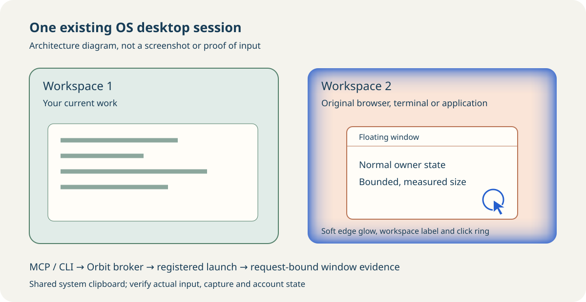
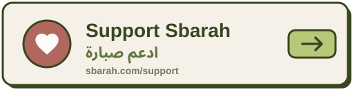

# Orbit

[Latest release: 0.3.2](https://github.com/M7MMAD-OMAR/sbar-orbit/releases/latest)
| [Release notes](docs/release-0.3.2.md) | [Changelog](CHANGELOG.md)

Open original installed native Linux applications on a numbered Hyprland workspace.
The user can select another workspace for their own work. Applications retain their normal owner state and
stay open after the opening worker exits.

Original browser and terminal registrations use the same native application route.
Copied profiles, private desktops and browser viewers are absent. There is no hidden or substitute session mode.

```sh
bun install --frozen-lockfile --ignore-scripts
./install.sh --dry-run --json
./bin/sbar-orbit applications Calculator
./bin/sbar-orbit native-open '{"workspace":2,"applicationId":"org.gnome.Calculator.desktop"}'
```

Opening requires configured native compositor metadata and owner action settings.
Protected mode asks for exact action approval; full mode uses the owner's standing authorization.
Explicit handoff enables target input and capture with a prepared plugin matching
current source and the running compositor ABI. Historical incident evidence is
[retained](docs/native-handoff-incident.md), not used as a permanent policy ban.
An acknowledgement is not proof of application acceptance or signed-in state.

See the [contract](docs/desktop-only.md), [CLI](docs/cli.md),
[connectors](docs/connectors.md), and [installation](docs/agent-install.md).

```sh
bun run typecheck
bun run verify
```

The supported suite never opens a browser or creates a private desktop. Unknown
measurements are reported as `not measured`, never as a pass.



This is an architecture illustration, not a screenshot. See [real installed app
results](docs/native-opening.md), [current shared clipboard acceptance](docs/native-acceptance-0.3.0.md), and [the platform matrix](docs/support-tiers.md).
Windows, macOS and other Linux compositor opening adapters are not implemented.
Complete application workflows, dialogs and other platform adapters need their own real acceptance.

## Support

Sbar Orbit is free and open source. If it makes your workday better, you can support its development:

<a href="https://sbarah.com/support"><picture><source media="(prefers-color-scheme: dark)" srcset="docs/assets/support-sbarah-dark.svg"></picture></a>
