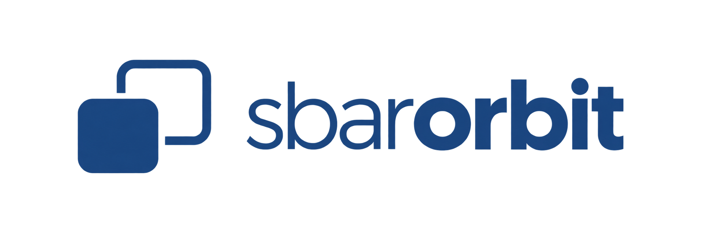

<picture>
  <source media="(prefers-color-scheme: dark)" srcset="brand/logo/lockup-latin-white.png">
  
</picture>

# Sbar Orbit

**Desktop application control for agents, with explicit application and window scope.**

Orbit is moving to a desktop-only public API. Standalone browser sessions are
retired. Agents use an owned private desktop or a configured native application
adapter; desktop failures must not fall back to browser automation.

Existing owner application handoff remains blocked by the documented compositor
crash release hold. Native support on Windows and macOS is not implemented.
See the [current migration contract](docs/desktop-only.md) before using an older
example or interpreting historical browser measurements as desktop support.

## Install

Requires [Bun](https://bun.sh). The current private desktop implementation requires
Linux and the documented native runtime. Installation alone does not prove
application control or other-platform desktop support.

```sh
bun add -g sbar-orbit
sbar-orbit install --connect auto
```

Or from source:

```sh
git clone https://github.com/M7MMAD-OMAR/sbar-orbit
cd sbar-orbit
./install.sh --connect auto      # Windows: install.cmd --connect auto
```

One command. It checks what the machine has, links the `sbar-orbit` command, starts the broker,
writes the MCP configuration for detected Claude Code, Codex and Hermes hosts, and verifies that
the installed broker answers. Restart those hosts to load Orbit's tools. Nothing needs root, and
`--dry-run` reports every step without changing anything.

Latest published version: **0.2.1** ([release notes](https://github.com/M7MMAD-OMAR/sbar-orbit/releases/tag/v0.2.1)).
This checkout contains the desktop-only migration. Until a new release is published,
the registry installation above installs the earlier product, not these changes.
See the [changelog](CHANGELOG.md) and [current documentation](docs/README.md).

## Use it

From an agent, through MCP: `orbit_create`, `orbit_act`, `orbit_observe`, `orbit_stop`.
From a terminal:

```sh
sbar-orbit applications
sbar-orbit session create system
sbar-orbit session observe SESSION_ID --metadata
sbar-orbit session stop SESSION_ID
```

Discover applications before choosing launch arguments. The private desktop uses
fresh application state unless a documented application adapter says otherwise.
The existing owner handoff path is release-blocked. See
[agent interface](docs/agent-interface.md) and [desktop-only](docs/desktop-only.md).

Turn Orbit off for one conversation with `sbar-orbit usage off`, on again only when you ask.

## Supported systems

| System | Desktop-only state |
| --- | --- |
| Linux with bundled native runtime | Private desktop implementation; capability-specific acceptance still required |
| Existing Hyprland owner applications | Release hold after a compositor crash |
| Windows and macOS | Native desktop adapters not implemented; runtime not measured |
| Other operating systems | Unsupported until a native adapter and runtime acceptance exist |

Historical browser results in [support tiers](docs/support-tiers.md) remain
historical evidence and do not imply desktop support. The product resolves user
locations and applications dynamically rather than relying on one person's paths.

## Documentation

| Guide | Purpose |
|---|---|
| [CLI](docs/cli.md) | Every command, the socket API and the action set |
| [Connectors](docs/connectors.md) | MCP host setup |
| [Agent interface](docs/agent-interface.md) | What an agent should do, and what each call costs it |
| [Architecture](docs/native-adaptive-architecture.md) | Native capability discovery and platform adapters |
| [Native desktop](docs/desktop-only.md) | Current session list, configuration and measured limits |
| [Resource limits](docs/resources.md) | The shared CPU and memory budget |
| [Support tiers](docs/support-tiers.md) | What is known to work, where, on what evidence |
| [Documentation index](docs/README.md) | Current contracts and retained historical evidence |

## Support the work

Orbit is Apache-2.0, runs entirely on your machine and sends nothing anywhere. There is nothing
behind it but time. If it saved you some:

<a href="https://www.buymeacoffee.com/m7mmadomar"></a>

A report from a machine this project has never touched is worth as much. Orbit is measured on one
host class, so `sbar-orbit doctor --report` from another system is evidence it cannot produce for
itself.

[Contributing](CONTRIBUTING.md) · [Security](SECURITY.md) · [Code of conduct](CODE_OF_CONDUCT.md) · [Changelog](CHANGELOG.md) · [Apache-2.0](LICENSE)

## Desktop guide pilot

The [14 October desktop pilot](docs/desktop-guide.md) retains four real application
openings and a limited calculator accessibility sequence. Its approved visual
guide is optional and sends no input. Existing owner Chrome control was not
completed; native handoff remains held.
