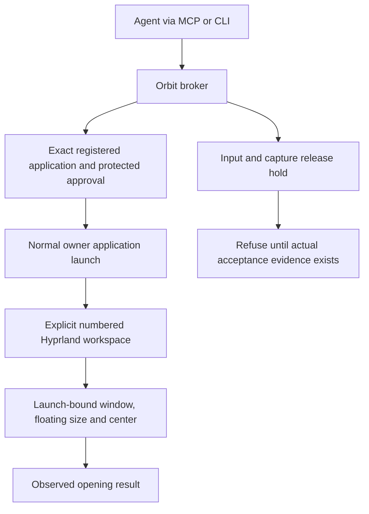
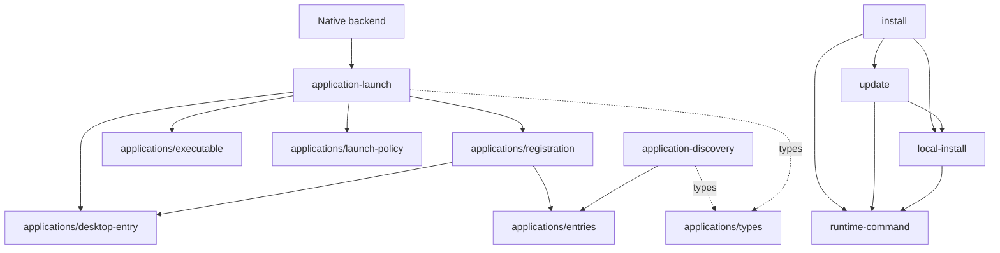

# Native application architecture

The broker accepts owner-only Unix RPC, MCP and CLI clients. Application discovery
reads registrations and current-user process metadata without starting applications.
`native.open` accepts a registered applicationId and explicit numbered workspace.
It does not accept arbitrary executable arguments.

The registration resolver refuses browser and terminal registrations, unsupported
activation wrappers, profile overrides and shell expressions. Exact native
Python/GJS entry scripts and finite registered rendering/backend assignments are
supported without admitting generic interpreter evaluation commands. It resolves the
normal installed native application recipe, including its working directory.
The native opening worker checks the prepared compositor identity and protected
control approval before dispatch. The launch helper inherits the normal owner
environment, publishes a process identity receipt, and replaces itself with the
original application. Window acknowledgement binds the new window to that launch
ancestry and requested workspace. An uncertain acknowledgement retains evidence.
Applications remain open after the worker exits.

Existing owner application handoff is independently gated by the compositor crash
release hold. No new control lease is admitted without its required acceptance
evidence. Native actions require generated application/window identities, policy
admission and protected native controls. Stopping a handoff returns the original
application. The session registry has no browser or private compositor backend.

Browser launchers, browser automation dependencies, profile cloning, saved browser
accounts, profile restore, the private display bootstrap, browser viewers and the
browser extension were deleted. There is no automatic fallback and no settings
exception for a hidden or private session.

The supported tests exercise the native contract, launch attribution, lifecycle,
release hold, metadata and resource budget. They never open a browser or create a
private desktop. Unit fixtures do not establish live owner input support.

## Current execution path

The illustration is a diagram, not a screenshot or live control demonstration.

The Hyprland opening adapter has real local evidence. Other desktop opening
adapters are not implemented. Shared discovery and installation code do not change
that boundary. See [the platform table](support-tiers.md).

## Source module boundaries

`application-launch.ts` is the public launch orchestrator. Discovery keeps its
public API in `application-discovery.ts`. Shared application data and directory
traversal live below both entry points, so launching does not load the complete
cross-platform discovery implementation.

| Module | Responsibility | Runtime project dependencies |
| --- | --- | --- |
| `applications/types.ts` | Application metadata, discovery options and resolved launch recipe types | none |
| `applications/entries.ts` | Bounded directory enumeration and its shared entry budget | none |
| `applications/desktop-entry.ts` | Strict launch registration grammar, Exec tokenization and field expansion | errors |
| `applications/executable.ts` | Executable lookup, aliases, trusted interpreters and literal wrappers | errors |
| `applications/launch-policy.ts` | Native admission, rendering values and profile argument checks | errors |
| `applications/registration.ts` | Exact registration selection, root precedence, limits and reading | entries, desktop-entry, errors |
| `application-launch.ts` | Ordered recipe resolution and final working-directory/argument validation | application modules, errors |
| `application-discovery.ts` | Platform registration and running-process metadata discovery | entries, types and existing metadata helpers |
| `runtime-command.ts` | Current Bun executable and platform launcher name | none |

The strict launch parser deliberately remains different from the permissive
metadata parser in `desktop-exec.ts`. Discovery can report metadata without
establishing that a registration is executable through Orbit.

The installer, updater and local launcher now share command identity through
`runtime-command.ts`. Neither launcher-name lookup nor Bun selection imports
installation/update orchestration. Existing exports from `install.ts`, `update.ts`
and discovery remain compatible for callers.

## Keeping the boundaries intact

Run `bun run scripts/limited.ts bun run check:architecture`. The same check is part
of local verification and the platform source-contract CI. It rejects runtime
cycles, unresolved relative executable modules, production imports into tooling
or tests, and dependencies outside the explicit leaf-module rules. Its regression
suite was run against the original installer/update cycles before their removal.

The guard analyzes production TypeScript static imports, re-exports and literal
dynamic imports. Type-only edges are erased. It does not analyze Python imports,
computed imports, subprocess dependencies or native plugin calls. A passing graph
check establishes those source boundaries, not desktop or platform acceptance.

For a new launch capability, first choose its owner: grammar belongs in
`desktop-entry`, executable resolution in `executable`, admission in
`launch-policy`, and registration selection in `registration`. Add behavior tests
through the public launch API and preserve the order of checks. For a new OS or
compositor, implement and measure the platform adapter described in
[porting](porting.md); shared discovery types do not grant control support.

Broker session/policy orchestration, cross-platform discovery and Python native
workers remain separate substantial subsystems. Their lifecycle and permission
contracts continue to apply after this refactor.
