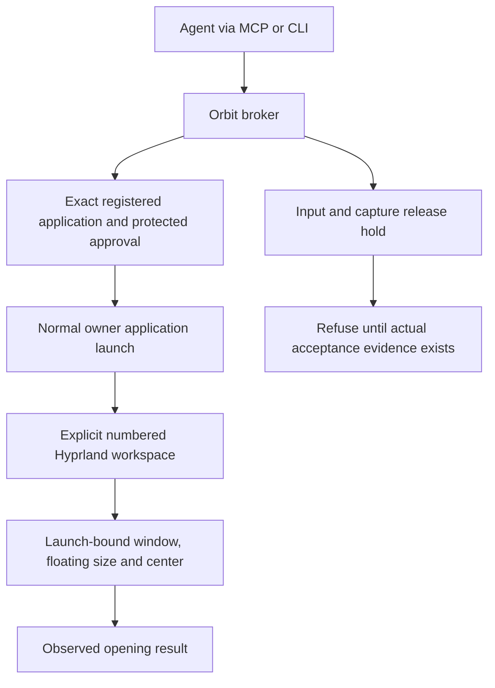

# Native application architecture

The broker accepts owner-only Unix RPC, MCP and CLI clients. Application discovery
reads registrations and current-user process metadata without starting applications.
`native.open` accepts a registered applicationId and explicit numbered workspace.
It does not accept arbitrary executable arguments.

The registration resolver refuses browser and terminal registrations, unsupported
activation wrappers, profile overrides and shell expressions. Exact native
Python/GJS entry scripts and finite registered GSK_RENDERER assignments are
supported without admitting generic interpreter evaluation commands. It resolves the
normal installed native application recipe, including its working directory.
The native opening worker checks the prepared compositor identity and protected
control approval before dispatch. The launch helper inherits the normal owner
environment, publishes a process identity receipt, and replaces itself with the
original application. Window acknowledgement binds the new window to that launch
ancestry and requested workspace. An uncertain acknowledgement retains evidence.
Applications remain open after the worker exits.

Existing owner application handoff is independently gated by the compositor crash
release hold. No new control lease is admitted without its required acceptance
evidence. Native actions require generated application/window identities, policy
admission and protected native controls. Stopping a handoff returns the original
application. The session registry has no browser or private compositor backend.

Browser launchers, browser automation dependencies, profile cloning, saved browser
accounts, profile restore, the private display bootstrap, browser viewers and the
browser extension were deleted. There is no automatic fallback and no settings
exception for a hidden or private session.

The supported tests exercise the native contract, launch attribution, lifecycle,
release hold, metadata and resource budget. They never open a browser or create a
private desktop. Unit fixtures do not establish live owner input support.

## Current execution path

The illustration is a diagram, not a screenshot or live control demonstration.

The Hyprland opening adapter has real local evidence. Other desktop opening
adapters are not implemented. Shared discovery and installation code do not change
that boundary. See [the platform table](support-tiers.md).
