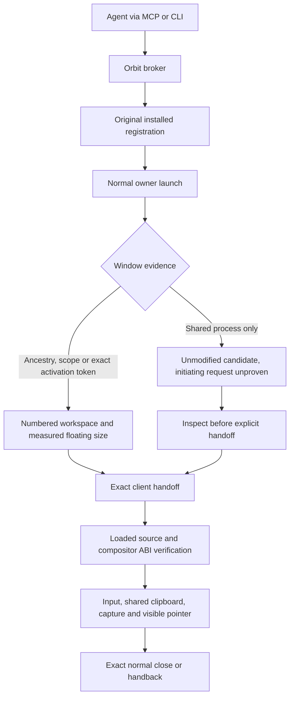

# Native application architecture

The broker accepts owner-only RPC, MCP and CLI clients. Discovery reads installed
registrations and current-user metadata. `native.open` accepts an exact registered
applicationId and an explicit visible numbered workspace, not arbitrary arguments.

Original browser, terminal, interpreter and vendor-wrapper registrations use their
normal executable recipe, owner environment, working directory and profile. A
Terminal=true entry uses xdg-terminal-exec where installed, with original Ptyxis,
Konsole or GNOME Terminal registrations as supported fallbacks. No private desktop,
browser viewer, copied profile or generic browser automation route exists.

The launch helper records its PID/start identity and uses an owner-lifetime
application scope. The normal startup environment also carries a unique
activation token. The plugin observes the actual Wayland activation request and
binds that token to its surface, without treating it as authorization to focus.
New windows with launcher ancestry, verified membership of that exact scope, or
this exact activation correlation can receive bounded floating placement. Pre-existing windows
are excluded by address and stable ID. A shared registered D-Bus process is a
weaker identity: another owner action can map a window in the same process.
That path returns `opened:false`, `attribution:candidate-only`, a candidate and
`placementChanged:false`. It does not relocate, resize or claim that window.
Inspect the candidate before an explicit exact handoff. Uncertain delivery is
never blindly relaunched; reuse the same requestId.

Opening requests silent placement, no initial focus and disabled focus-on-activation.
An existing activation server can activate its application before request
attribution. Orbit does not dispatch owner refocus or warp the physical pointer
back. If a new exact candidate already has owner focus, it returns `opened:false`
with `candidateReason:owner-input`, without post-map placement. Inspect that
candidate without taking owner input. A focus race after earlier placement
returns opening uncertainty rather than claiming no placement happened. These
checks do not prove that arbitrary applications never activate themselves.

Native handoff verifies the loaded plugin source and running compositor ABI.
It grants the selected window's entire Wayland client. The native default permits
ordinary actions; an owner can explicitly narrow it. Copy and paste use the
ordinary shared system clipboard and PRIMARY selection. Owner focus, hover and workspace changes never end, block or pause the
lease: agent input is client-local and does not go through the seat. Real key,
button or wheel input delivered to the client pauses agent input for about two
seconds after the last such event, then it resumes by itself. Claims never
change owner focus or physical pointer coordinates. Lease loss is distinct from window disappearance: inspect
native candidates before concluding that a normal close request succeeded.

Input coordinates and capture account for client surface geometry. A render-only
agent pointer and full monitor frame with a numbered workspace label show active control, hide on pause and
return on resume. A short click ring marks actual input; only the latest
interaction pointer is drawn on each monitor. A new cross-client portal dialog
with a verified compositor parent follows the controlled workspace before
mapping, with placement only. Input requires its own exact handoff. Existing
unrelated dialogs are preserved. New same-client windows receive a floating size request and
workspace rule; toolkit constraints can change the actual size. Observe and verify
actual geometry. `close-window` requests exact normal closure. Stop hands control
back and leaves applications open. No shared application process is killed.

## Current execution path

The illustration is a diagram, not a screenshot or live demonstration.

Fedora/Hyprland has actual local measurements. Other compositor/platform native
adapters and XWayland control are not implemented. Metadata and installation
contracts do not establish desktop acceptance. See [support tiers](support-tiers.md)
and [current native acceptance](acceptance.md). Historical incident
reports remain evidence, not a permanent static ban.
