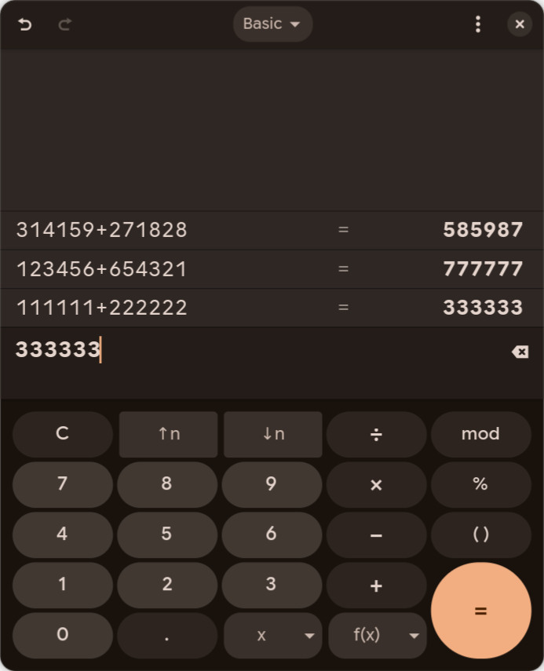

# Current original application acceptance

Measured on 22 October 2026 on Fedora 44, Hyprland 0.56.2, native Wayland,
x86_64. This report supplements the historical failures in
[external agent acceptance](external-agent-acceptance.md) and
[native opening](native-opening.md). Earlier failures have not been relabeled.

## Real shared clipboard workflow

The owner chose the ordinary shared system clipboard. Original GNOME Text
Editor and Calculator ran on visible numbered workspace 2, with normal owner
state and explicit floating sizes. There was no substitute desktop, copied
profile, fake application or browser viewer.

A real external Claude Code process, using Orbit MCP tools, typed in Text Editor,
used native copy and paste, observed the expression in Calculator and evaluated
it. Its first preparation/capture attempts exposed real defects and needed
retries. They are diagnostic evidence, not a clean first-attempt pass.

After the keyboard fixes, a direct Orbit workflow completed three consecutive
cycles without retrying any input. Before each paste, an ordinary system
clipboard read matched the exact expression selected and copied in Text Editor.
Calculator received native Paste and Return, not a second text injection.

| Copied expression | Actual Calculator result |
| --- | --- |
| `314159+271828` | `585987` |
| `123456+654321` | `777777` |
| `111111+222222` | `333333` |

This is an actual target capture from the normal installed Calculator. Its
history contains all three transfers. The disposable editor document was saved,
then both exact test windows received normal close requests. Candidate discovery
confirmed workspace 2 was empty afterward. Session stop handed the clients back.
No shared process was killed.

The tested plugin source SHA-256 is
`47c298b08715df56c3cc56573735a4518ec815171e47ca5128a09989cdaeef7d`.
The compositor stayed the same live process across plugin replacement and tasks.
This does not certify another compositor ABI or every Wayland application.

## Limits and additional measurements

The normal installed Chrome opened through its actual registration and displayed
its normal profile picker with owner profiles. That establishes an original
application/profile-picker observation. It does not establish a signed-in
website account or successful navigation. Private profile screenshots and raw
application logs are not published.

Full physical-monitor captures showed the original Calculator on workspace 2,
with the automatic agent pointer and colored frame. Both disappeared on pause
and returned on resume. This was the actual desktop, not a browser viewer.
A capture at 3840 by 2160 showed the entire Calculator UI after the desktop
rendering repair. An earlier full-monitor sample preserved the exact owner focus
and pointer. Another sample changed during concurrent owner activity and remains
inconclusive. These samples do not establish universal interference freedom.

## Fresh external agent on the managed service

After managed broker activation with the final source-matched plugin, a fresh
Claude Code process used only current Orbit MCP tools. It clicked the original
Calculator buttons for `2`, `+`, `2`, `=`. Its actual screenshot showed `4`.
No expression text was injected for that pointer task.

It then opened the original Text Editor and a second Calculator. It preserved
the restored saved document and used a new disposable draft. Native Copy
transferred `12345+67890` through the shared system clipboard. Native Paste
placed it in Calculator, and a pointer click on Equals produced `80235` in the
actual screenshot. It closed its exact windows normally, discarded only its own
draft, verified workspace 2 empty and stopped all three sessions. Window-only
captures do not include the compositor overlay; the full-monitor measurement
above is the separate evidence for that visible overlay.

A fresh Hermes task received the current `applicationId` schema after its Orbit
adapter was reconnected. It opened original Calculator, entered `2468+1357`,
evaluated, moved the agent pointer, normally closed its window and stopped its
session. Its Orbit-only toolset returned image paths without a viewable image
block, so that agent correctly left visual result verification unproven. The
coordinator separately inspected the actual saved PNG and read `3825`. This is
a split operation/visual check, not a claim that the Orbit-only Hermes task saw
the image. Include the host's image inspection capability for autonomous visual
workflows. A separate Hermes image-inspection attempt failed because its
configured vision provider returned HTTP 404 for an unavailable model. Orbit
application input and capture completed, but end-to-end autonomous Hermes
visual acceptance remains unproven on that provider configuration.
Cached machine-level agent instructions also needed the obsolete hold
removed; updating the MCP server alone did not update those instructions.

A fresh external Chrome test opened the original normal-profile picker on
workspace 3 at 1000 by 720. Its lease subsequently disappeared while the window
remained open. That was the owner's currently visible workspace and the real
pointer lay over the test window. The plugin hands a client back when it regains
real seat focus; this is a plausible cause, not a proven causal reproduction.
The exact test window was moved to workspace 2. A fresh external agent then
completed capture, pointer movement, state inspection and normal closure with a
stable lease. No owner Chromium window or profile was changed. The manually
relocated window reported tiled geometry, so that recovery is not evidence for
retaining the requested floating size during an arbitrary relocation.
A separate fresh opening through the normal Orbit route on workspace 2 then
completed handoff, capture, state and normal closure with actual floating
geometry 1000 by 720. Its scope is the original profile picker, not navigation
or authenticated account acceptance.

## Twenty original applications

The original registrations below completed bounded floating opening, an exact
native client handoff, actual target capture, state inspection and normal closure
of the newly created test windows. Workspace 2 was checked empty between tasks.
The sweep used the same live compositor process and ordinary owner state.

| Original application | Operation measured |
| --- | --- |
| GNOME Calculator | Open, capture, state, close |
| GNOME Text Editor | Open, capture, state, close |
| Files, Nautilus | Open, capture, state, close |
| Archive Manager, File Roller | Open, capture, state, close |
| Characters | Open, capture, state, close |
| Clocks | Open, capture, state, close |
| Calendar | Open, capture, state, close |
| Contacts | Open, capture, state, close |
| Maps | Open, capture, state, close |
| Logs | Open, capture, state, close |
| Decibels | Open, capture, state, close |
| Showtime | Open, capture, state, close |
| Papers | Open, capture, state, close |
| Fonts | Open, capture, state, close |
| Disk Usage Analyzer, Baobab | Open, capture, state, close |
| Ptyxis | Open, capture, state, close |
| Konsole | Open, capture, state, close |
| Dolphin | Open, capture, state, close |
| GIMP | Open, replacement main window, capture, state, close |
| Inkscape | Original first-use setup, capture, state, close |

A repeated complete sweep after the focus-coherence repair used plugin source
SHA-256
`5d56c7c5e09c9f326fbab4708988f82176b0e92c6b5077b41c41b966d3d09e75`.
All 20 rows completed, all exact test windows closed normally and workspace 2
was empty afterward. Actual compositor geometry reported each test window as
floating. The managed local broker was then activated with this matching plugin.
The independent clipboard workflow above predates the final focus and window
lifecycle repairs; its source identity remains printed separately.

Opening, capture and closure are distinct from accepting keyboard or pointer
input, completing an editing task, or verifying an authenticated account. The
20-row sweep does not certify those additional operations. Raw Calendar,
Contacts, recent-file and profile captures remain private. XWayland control and
other compositor/platform native adapters remain outside the implemented route.

The configured Codex CLI provider rejected its default model before any Orbit
call. This is not a measured Codex application task pass. No model or credential
was replaced to manufacture one. Fresh Claude Code completed the managed native
pointer and shared-clipboard workflows described above.

## Request-bound 22-application measurement

After startup activation-token correlation was added, 22 unique original
registrations completed opening, exact handoff, capture, state and normal
closure. This adds original Google Chrome and the `Terminal=true` btop entry to
the 20 listed above. btop used the original installed Ptyxis registration as its
terminal host and exited through its normal `q` command. The sanitized
[per-application geometry matrix](native-matrix-0.3.0.json) identifies the source
and actual capture sizes. No profile images, recent documents or owner account
content are included.

The first Fonts attempt encountered a read-only correlation-info timeout after
its window had already mapped correctly. The exact existing window was
reconciled and normally closed without relaunching. A bounded retry of only that
read-only query was then added, and a fresh Fonts row plus the remaining apps
completed. This is a repaired interrupted sweep, not a clean first-attempt pass.
Clocks and Maps also completed separate final-plugin checks using exact startup
activation-token evidence. A D-Bus PID alone is now candidate evidence and never
a reason to relocate an owner window.

A later fresh external task visually verified that closing a second Calculator
showing `80235` preserved the first window and its `4`. It also entered joined
Arabic text through native input. Its Save dialog escaped to the owner's
workspace and the requested destination was not created. That failed save was
retained as failure evidence and triggered the cross-client dialog repair.

## Full monitor indicator and native Save dialog repair

A new cross-client dialog follows an actual compositor parent in an active
controlled client to its numbered workspace before mapping. This is placement
only; the portal client requires a separate explicit handoff for input. Existing
unrelated windows are excluded. Parent links are checked with a bounded walk and
cycle detection. No PID or application-class guess grants dialog placement.

With plugin source
`8f6c7a9ee882842aef45e8c7524175756b0bd83c392ce486120d1e1a632126c5`,
an actual original Text Editor draft opened its KDE Save portal on workspace 2.
The portal was separately handed off and received a full destination path through
native input. A native click on Save created the requested disposable file.
An independent byte read matched `Orbit visible workspace test`, a newline,
`مرحبا Orbit` and a final newline, SHA-256
`f81ecd183c5f51f7ac299d95b95e05e4d3d76ae7b9424dd075aecf981f233cc2`.
Only the new editor and portal windows were closed, and workspace 2 was verified
empty. No shared process was terminated.

Full physical-monitor captures at 2560 by 1600 showed a thin frame along all
four monitor edges, the `Orbit | Desktop 2` label, a render-only pointer at the
interaction location and the short click ring. This was the normal desktop and
its original applications. The owner's other monitor was not marked. The later
source selects only the most recent interaction pointer per monitor, avoiding
stale pointers from the editor underneath its portal. This measurement does not
certify every toolkit's dialog protocol or another compositor.

## Fresh external completion after the portal repair

A fresh Claude Code process using only Orbit MCP tools completed the full task
with plugin source
`220f0ac2b7fbfdbb7d980d41cc0bbb589eece6d2bb13bc28ed089416087d8817`.
After a monitor change made workspace 2 the owner's current workspace, the test
used the real numbered workspace 5 without switching the owner away. It did not
create a substitute desktop. The task verified pointer-button `2+2=4`, a second
Calculator, shared Copy/Paste yielding `80235`, preservation of the first `4`,
joined Arabic text and a separately handed-off native Save portal on workspace
5 at 900 by 650. Normal closure removed only its test windows, and two final
candidate checks found workspace 5 empty.

The coordinator independently read the saved file. Its 29 UTF-8 bytes were
exactly `12345+67890`, newline, `مرحبا Orbit`, newline, SHA-256
`33d9c5d5baae8efc28e773b33053eb55900fc54a085365bbbad3cb13fc0fed00`.
That external agent did not inspect full-monitor captures and correctly did not
claim visual acceptance of the compositor overlay. That is a separate check.

A prior external attempt on the then-current owner workspace 2 lost its lease
while its original Calculator remained open. At inspection time the monitor
configuration had changed and the owner's physical pointer was over that
window. The cause was not established by that observation. Direct repeated
read-only operations on the exact same window subsequently succeeded. Those
failed attempts are not relabeled as successful or blamed on an RPC without
causal evidence. Lease loss now closes the backend and updates session status;
it still does not establish that a window closed. The coordinator normally
closed that exact leftover test window and verified its disappearance.

The external task also observed a compositor address reused for a later portal
with a different stable ID. Exact lifetime-bound selection distinguished them.
Reported capture pixels are not logical window dimensions, and handoff metadata
is an initial acknowledgement, not a continuously refreshed window census.

## Original Chrome profile and account UI

A fresh external Claude task opened the registered original Google Chrome on
workspace 5 at 1000 by 720. The normal owner profile picker showed an
unambiguous matching owner profile. A native pointer click selected it and a
new browser window replaced the picker in the same client. Existing owner
windows were preserved.

Using native keyboard input in a new temporary tab, the task opened
`chrome://version` and observed the ordinary owner configuration path, with no
`--user-data-dir` override or temporary copied profile. It then opened
`chrome://settings/people` and visually observed an owner account card indicating
Chrome sign-in. Account identifiers and profile screenshots remain private. This
is Chrome account UI evidence, not proof of sign-in on every website or of sync
status. No sign-in, sign-out or preference change was performed.

The agent initially supplied a narrower session policy that excluded normal
closure's action class. That first close was denied without delivery. It handed
the session back, selected the exact same new window with closure permission,
closed it normally, verified workspace 5 empty and stopped both sessions. This
was an agent-chosen policy exclusion, not the native default. The handoff tool
now explicitly says to omit policy unless the owner requests narrower controls,
and that a supplied allow list replaces the default. This interrupted close is
not a clean first-attempt pass.

## Final indicator comparison

The final source above was also exercised on the physical workspace 2 monitor
with an original Calculator and an actual click on `2`. Matched 2560 by 1600
monitor captures showed the full-edge frame, `Orbit | Desktop 2`, one agent
pointer and a click ring. Pause removed the frame, label and agent pointer;
resume restored them. The independent physical owner pointer stayed visible.
The exact new Calculator was normally closed and workspace 2 was verified empty.
The captures are private owner desktop evidence, not published product images.

## Visible presentation without owner focus switching

This section records an earlier implementation stage. Its interim teal indicator
and private presentation entry are superseded by the restored original gradient
and public broker-path measurement appended below. The earlier failures and
observations remain historical evidence.

A later owner report identified a flaw in the private acceptance helper: it
showed a workspace by focusing that workspace, focusing the owner workspace
again and restoring cursor coordinates. Matching final snapshots did not prove
that no transient focus change occurred. That helper is retired for presentation.
No global focus-follows-mouse or cursor preference was disabled.

The replacement native command is `ghost-workspace-present WORKSPACE MONITOR`.
Loaded source was
`4266f4a2e39ca7ae4dd185e10ee9cba3e1631aeb318ecdb292eee5d57434908c`,
against the same previously measured Hyprland ABI. On this two-monitor host,
three actual presentations, external workspace 7 to 4, 4 to 7 and final 7 to 4,
returned success. Every before/after sample retained the same owner window
identity, focused laptop monitor on workspace 1 and exact cursor coordinates.
The native call also compared real keyboard and pointer focus within the
compositor operation. These samples do not establish behavior for every owner
configuration, other compositor or a single-monitor simultaneous view.

An initial implementation updated active workspace membership without resetting
its previous hidden animation state. Full physical screenshots showed only the
wallpaper and indicator, so this was not accepted as application visibility.
Instant incoming and outgoing visual state updates corrected that defect without
focus dispatchers or simulated pointer motion.

Fresh full-desktop captures at 3840 by 3960 then showed the original Calculator
on external workspace 7 and the owner's independent laptop content. The eight
logical pixel teal frame, inner wash, workspace label below the panel and larger
agent pointer appeared during control, disappeared on acknowledged pause and
returned on acknowledged resume. Images were privately inspected and remain
outside this public repository because they include unrelated owner content.
The Calculator negotiated 568 by 855 logical pixels at handoff; the earlier
720 by 640 opening candidate is not its final measured size. A delivered click
placed the pointer over digit 2, but the captured entry remained empty, so no
digit acceptance or click-pulse animation pass is claimed for that capture.

Normal closure of that exact test window was acknowledged; workspace 7 then
had zero candidates. The session was stopped and external workspace 4 was
restored through the new presentation command with owner focus and cursor
unchanged. The focused Bun run passed nine tests in two files, including Python
compilation of the actual C++ presentation function with focused-output, special
workspace, already-visible workspace and callback-change cases. At that stage, the complete
release suite and fresh independent release review remained pending. The
presentation command had not yet been exposed as a public MCP operation.

## Concurrent shared portal dialog exclusion

A later real test used original GNOME Text Editor on workspace 5 and original
Papers on workspace 6. The editor's Save dialog was handed off before Papers
opened its own Open dialog. Both dialogs belonged to the same portal client,
while their compositor-verified parents belonged to the two separately
controlled test applications.

With loaded plugin source SHA-256
`57ba7421d54bb7655f90bcef1584757dde8b10d99c227d815a1da9b19db32446`,
the Save lease reported `windowEnrollment: selected-dialog-family`, one enrolled
window and `excludedWindows: 1`. Its public window list remained one after the
second dialog appeared. Actual compositor metadata kept the dialogs separately
on workspaces 5 and 6, both floating at 900 by 650 logical pixels. The other
same-client dialog was not enrolled or relocated by the Save lease. This is a
real shared-service exclusion measurement, not an inference from a shared PID.

Both portal dialogs and the Papers test window were normally closed. Closing
the editor produced a genuine Save Changes prompt for the sole new test draft.
The coordinator observed that exact prompt and discarded only that disposable
draft, preserving restored saved documents. Final candidate checks found
workspaces 5 and 6 empty. No shared process was killed. This verifies the tested
dialog families, not every application's portal protocol. Clipboard and seat
protocol authority remains client-wide; target enrollment is not OS isolation.

## Actionable loaded-plugin mismatch

A real original Calculator was opened while an older native plugin remained
loaded. The attempted handoff returned the public code `NATIVE_INCOMPATIBLE`
and an actionable instruction to prepare the current compositor and rebuild and
reload its matching plugin. Original opening was distinct from the failed
handoff. This probe verifies the public mismatch path; it does not turn that
failed claim into a control pass or certify a different compositor ABI.

## Restored original gradient and public presentation

The later indicator measurement used loaded plugin source SHA-256
`0d0f6e51e862ffbe090e8e7e41becbc34b0346a67382303e8fe224e9be71fd25`
against the same measured Hyprland ABI. The original Calculator opening remained
`OPENING_UNCERTAIN`. The coordinator did not relaunch: it separately inspected
the exact mapped candidate and handed off that original window on workspace 7.
The acknowledged selected surface was 720 by 640 logical pixels. This is an
inspected recovery from uncertain opening, not a clean launch pass.

The native presentation first showed workspace 7 on the external output while
the laptop output remained focused on workspace 1. Before/after presentation
samples retained the same owner window identity and physical cursor position.
The compositor also acknowledged its bounded focus-preservation check. This is
not continuous interference certification during arbitrary concurrent owner work.

Three settled, privately inspected full-desktop captures at 3840 by 3960 showed
the actual Calculator in the active, paused and resumed states. Active and
resumed captures showed the original soft blue gradient along the external
monitor edges, the `Orbit | Desktop 7` label and a separate render-only agent
pointer. The paused capture retained the original Calculator and removed those
activity cues. The laptop output was not marked. All three metadata samples
reported the laptop output focused on workspace 1, the external output on
workspace 7, and identical physical pointer coordinates. Owner application
content changed independently between samples, so no invariant content claim is
made. The full images and owner identifiers remain private.

The restored source uses the existing panel `frameColor`, `framePulse` and
`frame` preferences at handoff. The default is original Orbit blue `#255fce`,
with the original soft gradient and eased breathing. These still captures
establish the displayed blue gradient and pause/resume cues, not exact pulse
period, live settings changes or complete GTK theme matching. The limited accent
resolver records the original blue fallback when it cannot resolve user GTK CSS.

After the public tools were wired, a real broker `native.monitors` read showed
`eDP-1` focused on workspace 1 and unfocused `HDMI-A-5` displaying workspace 7.
A request-bound public `native.present` call selected workspace 4 on that exact
external output. It returned `visible: true`,
`ownerFocusPreserved: during-presentation` and
`sampled: compositor-acknowledgement`. A subsequent public monitor read showed
external workspace 4 while the laptop remained focused on workspace 1. No
output was chosen automatically and no focus-then-return fallback was used.
These broker-path measurements are distinct from a fresh external-agent MCP
acceptance task.

The coordinator verified cleanup: normal closure of the exact newly opened
Calculator, workspace 7 empty and the test session stopped. The public return
to workspace 4 did not require moving the owner's focus. This remains a Linux
Hyprland measurement on this host. Other Linux compositors and Windows native
control still require implemented adapters and actual host acceptance.

### Cold startup, current tools and restored document grouping

A native trace on the original Calculator showed no newly mapped compositor
client during the old 30 second opening interval. The loop therefore never
reached ancestry or geometry validation. A diagnostic-only extended opener
confirmed the real launch-bound, floating 720 by 640 window at 32.758 seconds.
That prototype is diagnostic evidence, not a production opening pass. No log
established whether a portal, accessibility service or another application
startup dependency caused the delay.

The production opening discovery interval is now 60 seconds, with 75 second
worker, 80 second IPC client and 90 second broker bounds. Opening identity tickets
last 90 seconds. A virtual-clock regression exercises discovery after 33 and
59 seconds without another launch. Delivery beyond the discovery interval still
remains uncertain; the original application is preserved and must be inspected.
The worker now explicitly receives HOME and XDG_CONFIG_HOME so native indicators
read the same owner preferences as the panel. The custom-root regression failed
before that propagation and passed afterward without inheriting unrelated
worker environment variables.

A fresh external Claude Code process received and called orbit_monitors and
orbit_present against plugin source 59bd03af9d90. Both original Calculator and
Text Editor returned opened:true with launch-ancestry evidence and the requested
720 by 640 and 900 by 650 floating sizes. Explicit presentation placed workspace
7 on the unfocused external monitor while the owner's laptop monitor retained
focus on workspace 1. Actual Calculator captures show 2+2 = 4, followed by
12345+67890 = 80235 after copying the expression from a new Text Editor draft
through the ordinary shared system clipboard. A separately handed-off native
Save dialog saved the Arabic draft. Independent file inspection found the
requested text plus the editor's ordinary final newline, 29 UTF-8 bytes.

This external run was not an uninterrupted document-preservation pass. The
agent used an unverified Ctrl+Shift+N shortcut, which moved an existing restored
tab into another window. Ctrl+N subsequently created the intended new draft.
The agent disclosed the changed grouping and closed only its draft and
Calculator. The coordinator restored the original four-tab order by normally
closing the moved saved-tab window and reopening its unchanged file in the
original group. The file retained its previously recorded SHA256 and 29 bytes.
A supplied enter key name was rejected before key delivery; the coordinator
inspected the remaining Open dialog and used its observed Open button instead.
No uncertain input was replayed.
The public key parser now normalizes the final enter token, including modifier
chords and mixed case, to canonical XKB Return. The transport-bound regression
failed on the unsupported aliases before the fix and passed afterward, while
canonical Return, KP_Enter and other keys retained their original spelling.

Fresh full physical desktop captures at 3840 by 3960 show the original blue
soft gradient, workspace 7 label and render-only pointer with the restored Text
Editor group. Pause hides these cues and resume restores them. The original
application remains visible in all three captures. The wallpaper cycles
independently, so unrelated background pixels are not a static reference. These
stills do not establish an exact pulse period or a click-ring duration.

The restored editor group was then closed normally, workspace 7 had zero
candidates, all test sessions were stopped, and the unfocused external display
returned to workspace 4. The owner's focused display remained on workspace 1.
Private raw transcripts, original application captures and file-integrity
records are retained outside the public repository. The earlier matrix and
acceptance records retain their original source identities and limits.

## Owner focus readiness correction

Independent source review found that an ordinary client claim could clear real
owner keyboard and pointer focus, including focus on a sibling window on another
workspace. The earlier implementation's focus-clearing behavior is superseded.
The actual claim function is now compiled in a regression probe. Against the
unfixed function, six scenarios failed because a claim enrolled a lease or
cleared owner focus. The corrected function checks both real keyboard and pointer
client identity before enrollment or lease mutation and reports `OWNER_BUSY`.

The probe covers selected and sibling surfaces for ordinary applications and
window-bound portal clients, plus successful claims while the owner uses another
client. It verifies unchanged keyboard, pointer and window focus, physical pointer
coordinates and no enrollment on busy claims. Focused transport and claim checks
passed: 20 tests, zero failures. This is compiled source and transport evidence,
not a live owner-focus takeover experiment.

The corrected plugin source
`8cf4c77f84f7efa3f546ee716df998cb62d4330ff0e36ce2d159928b76ece742`
was built against the running compositor ABI and loaded through the ordinary
owner plugin route. A production opening then created an original Text Editor
window on workspace 7, attributed by launch ancestry, floating at the requested
900 by 650 logical pixels. During this run, the coordinator
deferred presentation after monitor metadata showed that the external output
held owner focus on workspace 4. The coordinator guard ran before calling
`native.present`, so this did not measure the public tool refusal path. Older screenshots retain their original plugin source identity. Current
source UI acceptance requires its own paired captures; installing or loading the
plugin alone does not establish that acceptance.

### Claim validation and presentation readiness

A later source review found that a claim could restore routing rules from
another lease before rejecting an invalid identity or unsupported target. Five
compiled claim scenarios reproduced that mutation on the unfixed function:
malformed identity, reused identity, a missing xdg surface, an X11 sibling and
more than 64 windows. Validation now completes before transferring related
window routing. The same actual-function probe passed after the repair.

Presentation now distinguishes pre-mutation readiness from uncertain delivery.
The actual compositor function's focused-output, special-workspace and already
displayed guards use `PresentationNotReady`. Its post-mutation callback-change
error stays uncertain. A compiled regression failed on the old function's generic
error and passed after the typed repair. Together, the claim and presentation
compiled probes ran two tests with no failures. These fixtures do not replace
physical visibility or application-state measurements.

### Current compositor source and physical display measurements

Plugin source
`e018e8b8e9875da41497ff26eb209a3f8037e9391e3d3e64615c23234049947e`
was built, source/ABI checked and loaded through the ordinary owner route. An
original Text Editor opened on workspace 7 at 900 by 650 logical pixels with
launch-ancestry attribution and its normal four-tab document group. A real
public presentation request to the focused HDMI-A-5 output returned
`PRESENTATION_NOT_READY`; monitor metadata remained unchanged. This measures the
product refusal path, unlike the earlier coordinator-only guard. Live same-ID
retry after owner focus moves was not measured; transport/cache tests cover it.

An explicit request then presented workspace 7 on the unfocused eDP-1 output.
Three full physical desktop captures, each 3840 by 3960 pixels, show the original
blue gradient at that monitor's four edges, workspace label and separate pointer
during active control, absent while paused and restored on resume. The same
four-tab editor group stayed visible. HDMI-A-5 remained focused on workspace 4
and the physical pointer coordinates were identical in the three samples. These
are sampled states, not a continuous focus guarantee or an animation-timing test.

The exact newly opened editor window closed normally; workspace 7 was empty and
its lease stopped. By cleanup the owner display state on eDP-1 had changed to
workspace 2, so the coordinator preserved that change rather than restoring the
earlier workspace 8. The previously measured saved document remained byte
identical and its modification time unchanged.

A subsequent fresh Claude MCP process received the current tools, including
`orbit_monitors` and `orbit_present`. Its monitor result contained only focused
eDP-1 on workspace 2, with no HDMI-A-5. It stopped before opening or presenting
anything. This is fresh tool-receipt and readiness evidence, not a completed
Calculator task or a live Enter-alias acceptance result. Earlier external
application workflows retain their original source identities and limits.

### Opening and cleanup review corrections

Independent review identified a forwarded-opening Lua path that restored owner
focus and warped the physical pointer back after placement. That path is removed.
The actual generated Lua ran under LuaJIT against compositor API fixtures: the
unfixed code made seven dispatches, including one refocus and one cursor warp.
The repaired command makes no dispatch when the target is active or its exact
identity no longer matches. It applies only silent bounded placement while an
unrelated owner window remains focused. The native-opening wrapper passed four
tests including these behavioral Python/Lua cases. This is not a live forwarded
application activation experiment. Premap launch rules are requests, not proof
that arbitrary activation servers never take focus before attribution. An
active-after-placement race was separately reproduced: the old result wrongly
called the candidate unmodified. That race now returns opening uncertainty.

A second regression reproduced a presentation acknowledgement followed by worker
cleanup failure. The old code exposed the raw cleanup error despite the display
operation having completed. The repaired path reports `PRESENTATION_UNCONFIRMED`,
retains its private diagnostics and never replays that acknowledged mutation for
the same requestId. The focused presentation suite passed 11 tests, zero failures.

### Presentation admission and diagnostic catalog

A further regression exercised a presentation queued before an inner admission
refusal and a worker startup failure before any command. Both old paths retained
a rejection that prevented retry with the same identity. The unfixed product
failed those two cases. The repaired path retains each request fingerprint while
clearing only the pre-dispatch result, or reports typed startup readiness.
Post-dispatch uncertainty and cleanup after acknowledgement remain cached and
never replay automatically. The focused presentation suite passed 13 tests.

The diagnostic-code coupling check exposed missing presentation codes and three
obsolete codes left from removed functionality. The catalog now matches actual
throwers, its existing fixture uses a current code, and the default desktop suite
includes that coupling check. The combined focused run passed 16 tests without
failures. Earlier failed logs remain retained with their actual results.
