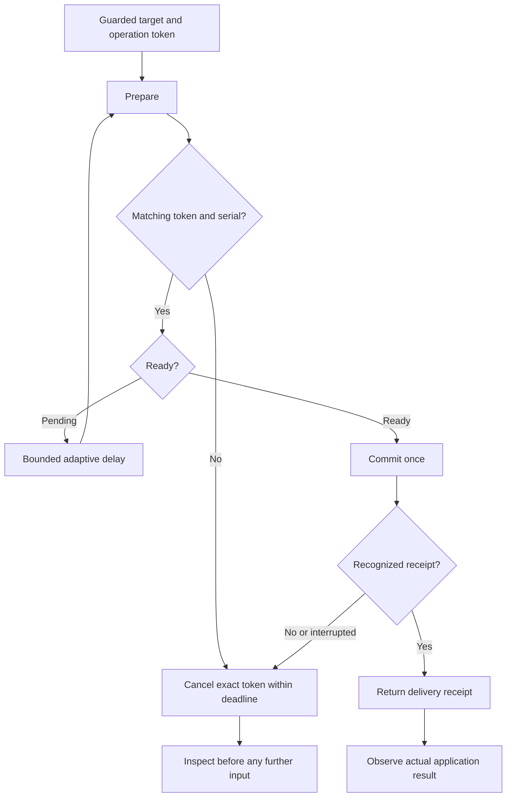

# Native keyboard reliability investigation

Investigation date: 26 October 2026. Scope: the Hyprland keyboard transport and
prepared key and text handlers. This report contains no account identifiers,
verification codes, private screenshots or user input text.

## Reproduced defects and source repairs

Modifier parsing previously accepted only `ctrl`, `shift`, `alt` and `super`
with that exact case. `CTRL+l` and `Control_L+l` reached the compositor and were
rejected. Modifiers now accept case-insensitive canonical names and the explicit
left and right XKB names, including `Control_L`, `Shift_R`, `Alt_L` and `Super_R`.
Left and right aliases select the corresponding logical modifier, not a physical
device or a side-specific hardware key.

A rejected key or text payload could leave its keyboard preparation pending.
The next operation then received `another keyboard operation is pending` until
cleanup, expiration or handback. Two layers now handle this:

1. The plugin consumes the matching prepared operation before validating its
   key or text payload. Invalid input sends no keystrokes and does not retain
   that operation. A different operation token cannot consume it.
2. The Python transport attempts token-bound cancellation in `finally` unless
   the commit returned a recognized success receipt. This includes failed or
   uncertain commit attempts and cleans up a rejection from an older plugin.
   Cancellation sends no input. A failed or uncertain commit is never replayed.
   The existing absolute deadline and server expiration remain in effect.

The regression checks execute the actual key and text C++ handlers in a compiled
fixture and exercise the Python transport through local Unix sockets. They fail
against the original source for modifier aliases and retained rejected key/text
operations. These are source and protocol measurements, not a completed browser
workflow or proof that a running installed plugin has been updated.

The normal verification suite includes `tests/native-transport.test.ts`, so the
socket rejection and no-replay checks are no longer confined to a manual run.

## Bounded preparation latency

The transport now polls pending preparation with delays of 1, 2, 4 and 8 ms,
then at most 10 ms per poll. Immediate readiness does not sleep. Every delay is
clipped to the existing absolute deadline; readiness must still carry the exact
operation token and unchanged configure serial. Slow acknowledgements can incur
more polling requests than the previous fixed interval, so the result is an
early responsiveness improvement, not a lower CPU or universal speed guarantee.

A recognized key receipt is exactly `ok`, after whitespace stripping. Text also
accepts the existing `ok N keys` receipt. These predicates are shared with public
transport response validation. A recognized receipt means the preparation was
consumed, so there is no redundant cancellation request after it. Rejections,
malformed replies and interrupted commits retain token-bound cleanup. No input
commit is retried because its reply is missing.

A local Unix socket fixture with exactly one pending reply per action measured
40 actions against baseline commit `2ef6b68` and 40 against this change, in an
alternating before/after order. Median transport duration was 11.963 ms before
and 2.389 ms after; p95 was 13.776 ms and 3.826 ms. Action request count fell
from four to three. This fixture controls readiness and does not measure desktop
rendering, model thinking, network latency or a real application's completion
time. Deterministic clock checks separately verify the delay schedule, deadline
clipping, immediate readiness, ambiguous delivery and rejected-reply cleanup.

An original installed GNOME Calculator was then opened on visible workspace 8
and controlled through a newly started native worker. Native text entered
`12345+6789`; Return produced the visibly observed result `19134`. The first
immediate capture still showed the expression, so a later observation verified
the result without repeating Return. The exact test window was normally closed
and candidate discovery verified its disappearance. Presentation used an
unfocused output, then restored its previous workspace after closure. No shared
broker restart or plugin replacement was needed for this Python worker change.
This is one Linux application acceptance case, not Windows acceptance or proof
of the benchmark's latency improvement in all applications.

## Existing application lease conflicts

One active lease covers an ordinary Wayland client, which can own multiple
windows. Opening a new window in that same client does not give a second task an
independent lease. The legacy plugin refusal `application lease already exists
or lease bound reached` is now classified as `APPLICATION_BUSY`, rather than
`INVALID_REQUEST`. The public worker message directs callers to inspect active
sessions and arrange an explicit handoff, without exposing another task's data.
Diagnostic metadata retains `APPLICATION_BUSY` instead of collapsing the refusal
into an unspecified backend failure.
Because that legacy reply also covers capacity, it does not identify a particular
lease or prove that any session is abandoned. There is no automatic takeover,
lease deletion or relaunch. A closed lease is not a closed application window.

The Python classification applies to newly started workers. The fixed public
message also requires a broker running the updated TypeScript source. An already
running shared broker must wait for a safe update boundary; it is not restarted
over another task to activate this message.

## Historical selection report and current native measurement

An original application workflow reported that selecting its address text and
then sending native text collapsed the selection and appended the new text.
Clearing the selection with BackSpace first was an observed workaround, not a
general repair. Automatically inserting BackSpace would destroy intentional
selections or existing content, so Orbit does not add it.

The current same-surface focus fixture checks that preparation does not resend
the keymap or keyboard enter when that resource remains enrolled and focused.
That fixture does not reproduce the complete application workflow. In particular,
it does not establish how an application reacts to per-operation XDG configure
events, popup transitions, owner input or a change of focused surface. No change
to those focus or configure paths is claimed as a selection fix here.

On 26 October 2026, the fix from commit `7274d69` was activated on the measured
Linux Hyprland 0.56.2 host. The loaded plugin reported source SHA-256
`1c680d1a0a2dd808b5c710aca05914c5c5680e8e89229f451ea2abbd3f6fd84d`.
Activation followed closed-session checks, broker update admission, a Wayland
input-idle notification and native unload readiness checks. The previous source
and preparation were retained for rollback. The broker was not restarted, and
update admission was released after the new loaded source was verified.

An original installed Chrome window was opened floating at 1080 by 740 logical
pixels on workspace 7, presented on an explicitly selected unfocused output.
Its normal existing profile was used without copying profiles or changing browser
security or detection settings. A local HTML document supplied single-line and
multiline fields with visible selection offsets and input event observations.
Input used Orbit native actions; no DOM control or browser automation backend
was used. Captures remained private.

The actual observations were:

- Selecting all 19 characters of `ORBIT_OLD_SELECTION` and typing
  `ORBIT_REPLACED` produced exactly that replacement, with caret offset 14.
- Selecting offsets 24 through 29 in `alpha ORIGINAL_SELECTED omega` and typing
  `RESULT` produced `alpha ORIGINAL_SELECTED RESULT`, with caret offset 30.
- `Control_L+l` visibly selected the local file address. Native text replaced it
  with `ORBIT_OMNIBOX_REPLACED`, without BackSpace in that replacement sequence.
  Return was not pressed, so the marker was not submitted as navigation.
- An intentionally invalid modifier was rejected. `CTRL+L` followed immediately
  by native text then succeeded in the same session, producing
  `ORBIT_AFTER_REJECT` in the address bar without a new handoff or session.

Initial loading of the local file used a cleared address field. That bootstrap
step is separate from the measured replacement sequence. Neither marker was
submitted. Existing owner window geometry and pointer coordinates were unchanged
in the baseline and post-opening samples. These are sampled observations, not a
continuous guarantee of owner state.

The reported selection collapse did not reproduce in these measured cases.
Its historical cause remains unestablished; the modifier and cleanup repair
must not be presented as proof of a general selection repair. A future recurrence
needs a bounded protocol trace and actual selection/caret observations around
surface, popup, configure and owner-input transitions before changing those paths.

On a later state check the test lease was already closed, and another task held
an active lease for the same Chrome client. Further input, pause/resume testing
and normal closure of the test window were not attempted under that lease.
Cleanup is therefore not a completed acceptance result. The outputs had also
changed, so the earlier output workspace was not forced back over the current
owner state. No other task's lease or windows were stopped to complete a test.

## Application acceptance and platform decisions

A native acknowledgement establishes protocol delivery, not completion of an
application action. Observe the actual application state after each material
step before continuing. An uncertain reply is a reason to inspect, not to repeat
typing, navigation, submission or publication blindly.

A platform challenge or account suspension occurring after an application task
does not establish that Orbit caused the platform decision. No platform reason
or causal link was verified in this investigation. No account login, publishing,
CAPTCHA, appeal, fingerprint modification or detection-evasion experiment forms
part of these checks. Human verification and platform restrictions stay with the
owner and the platform.

## Activation boundary

Source tests and an offline plugin build do not activate a fix. A changed plugin
requires a matching build, compositor ABI verification and an idle activation
boundary. Do not replace a loaded plugin or restart a shared broker while another
task has active work. Keep source verification, installed bytes and live native
application acceptance as separate reported facts.

## Text observation from the accessibility tree (Linux)

`orbit_observe` takes `format`: `image` (default, unchanged), `text` or `both`. `text` returns a compact
tree of visible nodes (role, name, states, `box` as `[x, y, width, height]` in the window local space the
click actions use, and the first 120 characters of editable text) and no screenshot. If the application
exposes no usable tree, the same call returns the screenshot plus `tree: {status: "unavailable", reason}`,
so the caller never has to retry. The tree is read through AT-SPI in a separate short lived process
(`src/native/a11y_dump.py`, 1.5 s walk deadline, 5 s process deadline, at most 300 nodes and 16000 bytes,
cut on a node boundary). The same read policy gate as image observation applies, so `orbit_narrow` scoping
holds. Every string is application controlled: it is flattened to one line, stripped of control
characters, length bounded, and delivered in its own block headed `UNTRUSTED APPLICATION DATA`, never in
the metadata block and never in a tool description or instruction.

Measured 29 October 2026 on this Fedora Hyprland machine, windows on workspace 4 (scale 1.5), from
`scripts/a11y-measure.py` (20 runs for Calculator, 10 for the others). Image is the PNG the worker
already returns (base64 adds a third); wall time includes the grim capture or the tree process start.

| Application | Image bytes | Image median | Text bytes | Text median | Nodes |
| --- | --- | --- | --- | --- | --- |
| GNOME Calculator (GTK4) | 46436 | 54 ms | 2300 | 199 ms | 37 |
| GNOME Text Editor (GTK4) | 42946 | 71 ms | 1317 | 180 ms | 18 |
| Dolphin (Qt6) | 103385 | 80 ms | 6516 | 201 ms | 97 |

So text is 18 to 35 times smaller but about 3 times slower to produce locally (a Python start plus the
D-Bus walk). The saving is in what the model has to read and in token cost, not in capture time. Whether
that halves the observe-to-action time depends on the model, and this was not measured end to end.

Whether a box center lands on the right control, checked by cropping a screenshot at the returned center
(no input was sent):

- Dolphin: the Trash tab center fell on the tab label. Correct.
- GTK4 Calculator: the Backspace button center was exact, but the number pad boxes were shifted by about
  12 logical pixels right and down (the `7` and `=` boxes), so the center landed inside the button but off
  center. A control smaller than about 24 pixels in that region could be missed. GTK4 reports some extents
  with a container margin, and Orbit does not correct it.

Live click check, 29 October 2026, through the loaded plugin on workspace 4 (workspace 8 was not displayed on
any monitor, and presenting it would have replaced the owner's workspace 1 output). GNOME Calculator was
opened with `orbit_open`, handed off, and observed with `format: text` through the broker
(`session.observe`). The centers of the returned boxes for `7`, `+`, `3` and `=` were clicked in that order
with `session.act`. The window showed `7+3` and the result `10` in a screenshot, so all four clicks landed on
the intended control. The same session measured, over the broker (JSON payload, 10 runs): image 56826 bytes,
median 87 ms; text 2936 bytes, median 203 ms. The boxes were again about 13 logical pixels right and down of
the visible button centers, and every click still fell inside its button. No coordinate correction was added at that time,
(superseded by "Box accuracy and web content" below) because the offset is a toolkit reporting artifact that differs by container (Backspace and the Qt apps had
none) and a blanket shift would break those. The window was closed with `close-window` and the session
stopped.

Limits, stated plainly:

- Chromium and Electron apps (Chrome, Chromium, Claude Desktop, VS Code on this machine) expose an empty
  stub tree until accessibility is enabled inside that browser process, so they fall back to the
  screenshot. Orbit does not change the owner's accessibility settings or relaunch the browser to force it.
  See "Browsers and Electron" below for what was measured.
- A window whose compositor title matches none of the application's accessible windows, with several
  windows open, is refused rather than guessed, and falls back to the screenshot.
- Windows (UI Automation) and macOS (AX) are not implemented and not measured.

## Box accuracy and web content (29 October 2026)

Root cause of the roughly 13 logical pixel shift on GTK4. GTK4 (4.22.5, `gtk/gtkwidget.c`
`gtk_widget_accessible_get_bounds` and `gtk/a11y/gtkatspiutils.c`) computes each node's bounds against its
widget parent, and `get_extents(WINDOW)` then sums those bounds along the accessible parent chain. Where the
accessible chain repeats or skips a wrapper widget, the sum is wrong. On the Calculator key grid a margin
container of 12 pixels appears on two nested wrappers of identical size, so every key below it is 12 pixels
right and down. `get_accessible_at_point` cannot detect this, because it recurses through the same
bounds and agrees with itself (checked: it returned the shifted label for its own shifted center).

Fix, in `src/native/a11y_dump.py` (`anchor`). A child whose size fits inside its accessible parent but
whose offset pushes it outside is re anchored to the nearest ancestor frame that holds it, and every
ancestor's correction is carried down to its children. Nothing else is moved, content below a scrolling
container is never moved (it is legitimately clipped), and the dump reports `recalibrated`, the count of
re anchored nodes. Applied to Dolphin (Qt6) and GNOME Text Editor it changed nothing (`recalibrated` 0).

Measured with live clicks through the broker on workspace 4 (scale 1.5). Calculator: the `=` key, orange
and 132 by 92, was clicked at its returned center (752, 582); the key in the screenshot has its center at
(751.7, 581.7), an error of 0.3 pixels (it was 12 before). `7`, `+`, `3`, `=` produced `7+3` and `10`.
Dolphin: the `Music` place was clicked at its returned center and opened Music (center error under 1 pixel;
the file list rows are Qt boxes that were already exact). Text Editor (the existing window on workspace
5, input limited to one click on the main menu button): not exact. Residual, measured and not fixed: GTK4
and libadwaita header bar buttons are reported about 7 to 8 pixels left and 6 up of where they are drawn,
in both Calculator and Text Editor, at scales 1.5 and 1.33 alike. No ancestor frame is repeated or skipped
there, so the tree itself holds no signal to correct it, and a constant would break other layouts. The center
still falls inside the 34 pixel header button (the drawn circle is about 23 pixels), so a click lands. A
pixel based check against the capture would be the next step.

Owner update, same day: Calculator is not a target app. Re measured on apps the owner uses, screenshots
compared with the returned box centers, workspace 4, scale 1.5:

| App | Control clicked | Center error (logical px) |
| --- | --- | --- |
| Chrome 156 page content (device pixel scaling) | checkbox 13 by 14, submit button | 0.3 and 0.7 |
| Dolphin (Qt6) | Music place | under 1 |
| Nautilus (GTK4) sidebar | Music item | 0.3 in x, 6 in y (inside the 40 pixel item, the click landed) |
| Nautilus (GTK4) file grid | not clicked | cells about 18 right and 24 down of where drawn, from the screenshot |
| Text Editor (GTK4) header | main menu button | about 6 and 6, landed on the button |

The GTK4 structure fix removes the repeated wrapper case only. The remaining GTK4 errors (header bar
about 7 right and 6 down, Nautilus sidebar 6 down, Nautilus grid cells larger) have no repeated or skipped
ancestor in the tree, so they are not recoverable from the tree alone; they are reported, not corrected.
Clicks on controls larger than twice the error still land. Small GTK4 controls near the edge can miss, and a
pixel check against the capture is the open next step.

## Browsers and Electron

What works without touching the owner's settings. Gecko (Firefox, Thunderbird) already publishes a full
tree when the session accessibility bus is active (this machine: 892 nodes for the owner's Thunderbird;
a fresh Firefox profile returned its dialog tree with exact logical boxes). Firefox page content was not
measured: a new profile opens a first run dialog that accepts Terms of Use, which was not clicked.

Chromium family (Chrome 156 measured). Listening on the bus does not turn it on. Tried and found
ineffective on a fresh Chrome process with its own temporary profile: the bus already reported `IsEnabled`
and `ScreenReaderEnabled` true; toggling both properties false and back; registering an AT-SPI event
listener; `ACCESSIBILITY_ENABLED=1` at launch. Only two things enabled the tree: the launch flag
`--force-renderer-accessibility`, and the in browser switches on `chrome://accessibility` ("Native
accessibility API support" and "Web accessibility", memory only, reset when the browser process exits).
Neither fits an automatic mechanism: the flag needs a new browser process, and the page switches change
every window of the owner's running process (accessibility slows page loads) and need a UI flow. Orbit
therefore does not enable it by itself. An agent that was asked to use a browser through Orbit may open
`chrome://accessibility` in a window it opened and tick the two boxes, knowing that this affects that
whole browser process until it exits. The enabled windows were closed afterwards.

With the tree on (fixture page served from localhost: form, links, a select, a checkbox, a modal dialog and
a 200 row scrolling list, Chrome window 960 by 640 at scale 1.5):

- The tree holds the browser chrome (tabs, back, reload, address bar entry with its text, bookmark), then
  the page: document, headings, paragraph text, links, text fields with their text, combo box, checkbox
  with `checked`, buttons, list items. Rows clipped out of the scroller are not showing and are left out,
  so the 200 row list costs about 10 lines; scrolling changes them. An open modal dialog leaves only the
  dialog content plus the browser chrome (19 nodes).
- Web content boxes arrive in device pixels while the browser chrome is in logical pixels (the document
  was 1440 wide in a 960 wide window). `device_scale` detects a `document web` whose far corner is the
  window's far corner times a factor above 1, and divides the subtree by it. After that, clicks at the
  returned centers worked: a text field, a 13 pixel checkbox, the submit button (page showed `Submitted
  Orbit Red`) and the dialog button, and a scroll over the list moved it.
- Payload and time, 15 runs, same window (image is the grim PNG the worker returns): form page 3471
  bytes of text, median 150 ms, 51 nodes, against 95484 bytes and 66 ms for the image; modal state 1468
  bytes and 107 ms against 100380 bytes. Text is 27 to 68 times smaller and 1.6 to 2.3 times slower to
  produce.
- Also in the dump: object replacement characters and bullets are dropped, and a `static` text repeating
  the previous node adds no line.

Not measured: Electron apps with the tree on (the Claude and Hermes windows were stubs and were not
changed), Wayland fractional scales other than 1.5 for web content.

## Window frame origin and the chrome://accessibility route (29 October 2026)

Coordinate space. Gecko (and any toolkit with client side margins) reports WINDOW extents in surface
space: a Firefox window with `geometry [24, 21, 960, 640]` in a 1008 by 688 surface returns its frame at
`[24, 21, 960, 640]` and every control 24 and 21 pixels further right and down than where `click`
lands, because the plugin maps click coordinates into the geometry. The dump now rebases every box to the
top left of the window frame (`origin` in the result is the subtracted offset, null when the frame is at
0, 0). Live, on the web flows fixture in the owner's Firefox, workspace 4, scale 1.5 (new window, closed
afterwards): the nav link `hover` (43 by 34) came back as `[141, 83, 43, 34]`, was clicked at its center
(162, 100) and navigated to `#hover` at once; before the change that box was `[165, 104, ...]` and a click at its
center landed 24 and 21 pixels off. Chromium frames and GTK4 frames (Text Editor, Nautilus, File Roller)
report origin 0, so nothing changed for them; no GTK window with client side shadows was available (no
GTK3 app installed), so that case is covered by the fake geometry test only.
The screenshot of such a window still starts at the surface origin until the capture crop is fixed by the
settle work; text boxes already match click space.

chrome://accessibility end to end, in a Chrome process I started with its own temporary profile (the
owner's running Chrome was not touched), a window on workspace 6, scale 1.33. The window was opened on
`https://en.wikipedia.org/wiki/Linux` without any flag, so the tree was a stub (`accessible window has no
visible content`). In a second tab `chrome://accessibility` was opened and the checkboxes "Native
accessibility API support" and "Web accessibility" were ticked by clicking their centers, then the
first tab was selected again. The page showed "Active assistive technology: Uninitialized"
before. Afterwards the text observation was a full tree, device scale detected as 1.333:

| | Bytes | Median (15 runs) | Notes |
| --- | --- | --- | --- |
| Screenshot (grim PNG) | 259042 | 50 ms | |
| Text observation | 9715 | 178 ms | 134 nodes, not truncated |

So text is 27 times smaller and 3.6 times slower to produce. The small link `Unix` (33 by 19 logical
pixels, fractional scale) was clicked at its returned center and the page navigated to Unix. The window
and its process were closed afterwards, which resets the switches.

## Settled capture and action batching

Measured 29 October 2026 on original installed GNOME Calculator, opened with `orbit_open` on the
displayed workspace 3 (workspace presentation was refused while the owner had focus on the other output),
handed off over a private broker and socket started from this checkout. No shared broker was restarted and
the owner's windows were not touched. The window this run launched was closed afterwards.

What changed. `orbit_act` accepts `actions` (up to 16 move, click, scroll, text or key actions on one
window, in order) and `capture` (a screenshot taken after the window stops changing). Each action passes
the same policy, lease and guarded target checks as a lone action; all are judged before the first input
is delivered. The first failure stops the list. Later actions report `not-attempted`, and a lost reply
reports `uncertain` and is never resent. One receipt is returned per action. The capture takes a digest of
the window before the first input, then polls until the frame differs from it and holds still for `capture.quietMs` (100 ms since the latency round below; 200 ms in the measurements above),
bounded by `capture.timeoutMs` (default 1500). Two identical frames alone are not accepted, because a slow
redraw leaves two identical old frames. The result reports `settled`, `changed`, `captures` and `waitedMs`;
`changed: false` after a 300 ms grace means nothing visibly happened, which is normal for a move. A replay
of the same `requestId` returns the receipts with the frame marked expired and re-executes nothing. The
separate `orbit_observe` path is unchanged.

The scenario: clear with Escape, type `12345+6789`, press Return, and get a frame showing the result. 15
runs of each flow, alternating, `experiments/settled-capture-measure.ts` for timing and
`experiments/settled-capture-analyze.py` for the verdict. A frame counts as stale when more than 0.2
percent of its 8 pixel blocks differ from an observe taken 900 ms later (the blinking caret changes about
0.03 percent). Times are the broker round trips only, with no model thinking time.

| Flow | Tool calls | Stale frames | Median ms | p95 ms |
| --- | --- | --- | --- | --- |
| text, key, observe, plus a second observe when stale | 4 (3 when fresh) | 15 of 15 | 172 | 223 |
| one `orbit_act` with `actions` and `capture` | 1 | 0 of 15 | 507 | 548 |

The batched call waited a median 332 ms and took a median 5 captures to settle; none was unsettled and
none reported `changed: false`. So the batched call costs more wall time inside Orbit, about 335 ms, and
removes three of four tool calls, each of which is a model round trip that this measurement does not
include. The saving is the model turns and the second observe; it is not a faster capture. In this
scenario the first capture after Return was stale every time, as in the earlier run above.

Limits. An earlier run with a 100 ms quiet period and a cruder staleness check (exact frame equality
against later frames) was inconsistent, 2 to 3 of 15 flagged and once 12 of 15, because a blinking caret
changes the bytes of an otherwise finished frame. That check was replaced, so those runs are not
comparable and are not reported. One application, one workload, one machine; an application that animates
continuously never settles and returns after `timeoutMs` with `settled: false`. A change smaller than the
caret blink after the first visible change can be missed.

### Latency round, 29 October 2026 (browsers, Text Editor)

Goal: cut the wait without returning stale or half drawn frames. Calculator was dropped at the owner's
request; the numbers above stay as history. Method as above (frame judged against an observe 900 ms later,
stale when more than 0.2 percent of 8 pixel blocks differ, plus a strict count of more than 12 blocks),
variants rotated run by run, a private broker from this checkout, the original installed application on the
workspace the unfocused output already showed. The window this run opened was closed afterwards. The tooling
is `experiments/settled-capture-measure.ts` (ORBIT_MEASURE_SCENARIO, ORBIT_MEASURE_VARIANTS) and
`experiments/settled-capture-analyze.py`. In the tables, classic is the previous loop (20 ms pause between
captures, quiet 200 ms), qN is no pause and quiet N ms, pipe3 is three captures in flight 15 ms apart.

| App and page | Variant | Runs | Stale | Unsettled | Median ms | p95 ms | Waited ms | Captures |
| --- | --- | --- | --- | --- | --- | --- | --- | --- |
| Chromium, local fixture | classic | 15 | 0 | 0 | 1074 | 2517 | 852 | 11 |
| Chromium, local fixture | q100 | 15 | 0 | 0 | 769 | 4301 | 491 | 8 |
| Chromium, local fixture | q60 | 15 | 7 | 0 | 573 | 5600 | 267 | 5 |
| Chromium, local fixture | pipe3 with q100 | 15 | 2 | 0 | 707 | 2759 | 496 | 14 |
| Chromium, final code | q200 | 15 | 0 | 1 | 1006 | 3094 | 770 | 11 |
| Chromium, final code | q100 (new default) | 15 | 0 | 0 | 678 | 3937 | 486 | 9 |
| Text Editor | classic | 8 | 0 | 0 | 432 | 1062 | 265 | 5 |
| Text Editor | q100 | 8 | 0 | 0 | 261 | 1248 | 118 | 3.5 |
| Text Editor | pipe3 | 8 | 0 | 0 | 426 | 1463 | 240 | 8 |
| Text Editor | pipe3 with q100 | 8 | 0 | 0 | 262 | 854 | 116 | 4 |

The fixture paints a list 80 ms after Enter and fades a panel in over 250 ms, so it is a hard case for a short
quiet period. Stale is 0 on both counts in every kept row. With 8 or 15 runs the p95 is the slowest run or
two; the slow runs of 1 to 4 s are in every variant and in the Text Editor case the wait itself was 260 ms of
a 1062 ms run, so they come from outside the settle loop and are not explained here.

Kept: no pause between captures and a default quiet period of 100 ms (`capture.quietMs`, 20 to 1000, raise it
for a page that repaints after a pause). Median 1006 to 678 ms on Chromium (about 33 percent) and 432 to 261 ms
on Text Editor (about 40 percent). Stale frames stayed 0, including for the two identical old frames rule,
which is unchanged: the frame must differ from the baseline first.

Not kept, measured. Pipelined captures (three in flight at once): no gain
alone (426 against 432 ms), and with q100 two stale frames of 15 on Chromium that the plain q100 did not
have, so the code was removed. A 60 ms quiet period (what a shorter quiet after a large change would be):
7 of 15 stale on Chromium; adaptive quiet (idea b) is therefore unsafe on this fixture and was not built.
A capture costs 25 to 70 ms by itself (grim on a 1 pixel region still takes 62 ms, so pixel count is not the
cost), which is why polling faster than the capture time buys nothing and the 20 ms pause only added delay.

Not done, with the reason. (c) Compositor damage events: the ghost cursor plugin only calls damage for its own
rendering and exposes no frame or damage event; a wlr or ext screencopy client with damage needs a native
Wayland client that Python does not have here, so this was not tried. (e) A region of interest: `orbit_narrow`
narrows permissions, not a region, so there is no such option; since capture time does not depend on size it
would only help windows that never settle. (d) The time outside the wait, call minus waited, was about
145 ms (Text Editor q100: 261 minus 118) for the baseline capture, input delivery and the IPC. The baseline
must be taken before the first input for the stale rule to hold, so only its 25 to 70 ms could overlap and
that was not attempted. Dolphin: the run failed on Return in the location bar with a native uncertain error
before any timing, and Firefox, Chrome and VS Code were not measured because Firefox was leased by another
session (APPLICATION_BUSY) and the owner was working in the others. The reduced scope is therefore Chromium
and Text Editor on one machine, 8 to 15 runs.

### Capture origin: image pixels and input coordinates (29 October 2026)

Firefox draws client side margins: `state` reports window 960x640, surface 1008x688, geometry [24, 21, 960, 640].
The plugin maps input into the geometry, while the capture started at the surface origin, so a point read off an
image landed 24 by 21 pixels from where the same coordinates clicked. A window whose geometry is not at 0, 0
is now captured as a raster, cropped to the geometry (scaled for the output scale) and re-encoded as PNG; the
cropped width and height are what `width`, `height`, `surfaceWidth` and `surfaceHeight` report, so the scale
stays exact. A window at 0, 0 (Chromium) takes the old path unchanged, and a window with no readable state is
captured uncropped. The capture only holds the window sized area, so the margin at the right and bottom edge is
not in it: the visible part is the geometry minus that strip (936 by 618.75 of 960 by 640 on this window).
Measured live on Firefox: the uncropped capture was 1280x853 and showed the margin; the cropped one was
1248x825 with surfaceWidth 936 and began at the browser chrome. Tests with a fake geometry offset, a fractional
scale, an out of range geometry and unreadable state are in `tests/native_settle_test.py`.

Not proven: the click on the 43 by 19 pixel "hover" link read straight off the capture. Firefox was leased by
another session when the proof ran, so `experiments/capture-origin-proof.ts` stopped at APPLICATION_BUSY.
The next run should use that script.
