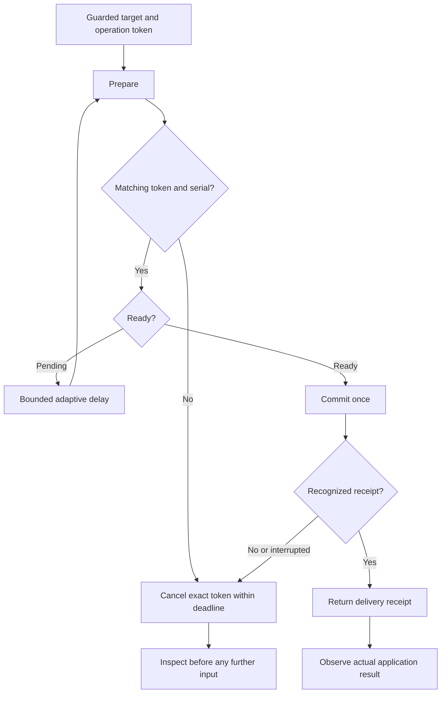

# Native keyboard reliability investigation

Investigation date: 26 October 2026. Scope: the Hyprland keyboard transport and
prepared key and text handlers. This report contains no account identifiers,
verification codes, private screenshots or user input text.

## Reproduced defects and source repairs

Modifier parsing previously accepted only `ctrl`, `shift`, `alt` and `super`
with that exact case. `CTRL+l` and `Control_L+l` reached the compositor and were
rejected. Modifiers now accept case-insensitive canonical names and the explicit
left and right XKB names, including `Control_L`, `Shift_R`, `Alt_L` and `Super_R`.
Left and right aliases select the corresponding logical modifier, not a physical
device or a side-specific hardware key.

A rejected key or text payload could leave its keyboard preparation pending.
The next operation then received `another keyboard operation is pending` until
cleanup, expiration or handback. Two layers now handle this:

1. The plugin consumes the matching prepared operation before validating its
   key or text payload. Invalid input sends no keystrokes and does not retain
   that operation. A different operation token cannot consume it.
2. The Python transport attempts token-bound cancellation in `finally` unless
   the commit returned a recognized success receipt. This includes failed or
   uncertain commit attempts and cleans up a rejection from an older plugin.
   Cancellation sends no input. A failed or uncertain commit is never replayed.
   The existing absolute deadline and server expiration remain in effect.

The regression checks execute the actual key and text C++ handlers in a compiled
fixture and exercise the Python transport through local Unix sockets. They fail
against the original source for modifier aliases and retained rejected key/text
operations. These are source and protocol measurements, not a completed browser
workflow or proof that a running installed plugin has been updated.

The normal verification suite includes `tests/native-transport.test.ts`, so the
socket rejection and no-replay checks are no longer confined to a manual run.

## Bounded preparation latency

The transport now polls pending preparation with delays of 1, 2, 4 and 8 ms,
then at most 10 ms per poll. Immediate readiness does not sleep. Every delay is
clipped to the existing absolute deadline; readiness must still carry the exact
operation token and unchanged configure serial. Slow acknowledgements can incur
more polling requests than the previous fixed interval, so the result is an
early responsiveness improvement, not a lower CPU or universal speed guarantee.

A recognized key receipt is exactly `ok`, after whitespace stripping. Text also
accepts the existing `ok N keys` receipt. These predicates are shared with public
transport response validation. A recognized receipt means the preparation was
consumed, so there is no redundant cancellation request after it. Rejections,
malformed replies and interrupted commits retain token-bound cleanup. No input
commit is retried because its reply is missing.

A local Unix socket fixture with exactly one pending reply per action measured
40 actions against baseline commit `2ef6b68` and 40 against this change, in an
alternating before/after order. Median transport duration was 11.963 ms before
and 2.389 ms after; p95 was 13.776 ms and 3.826 ms. Action request count fell
from four to three. This fixture controls readiness and does not measure desktop
rendering, model thinking, network latency or a real application's completion
time. Deterministic clock checks separately verify the delay schedule, deadline
clipping, immediate readiness, ambiguous delivery and rejected-reply cleanup.

An original installed GNOME Calculator was then opened on visible workspace 8
and controlled through a newly started native worker. Native text entered
`12345+6789`; Return produced the visibly observed result `19134`. The first
immediate capture still showed the expression, so a later observation verified
the result without repeating Return. The exact test window was normally closed
and candidate discovery verified its disappearance. Presentation used an
unfocused output, then restored its previous workspace after closure. No shared
broker restart or plugin replacement was needed for this Python worker change.
This is one Linux application acceptance case, not Windows acceptance or proof
of the benchmark's latency improvement in all applications.

## Existing application lease conflicts

One active lease covers an ordinary Wayland client, which can own multiple
windows. Opening a new window in that same client does not give a second task an
independent lease. The legacy plugin refusal `application lease already exists
or lease bound reached` is now classified as `APPLICATION_BUSY`, rather than
`INVALID_REQUEST`. The public worker message directs callers to inspect active
sessions and arrange an explicit handoff, without exposing another task's data.
Diagnostic metadata retains `APPLICATION_BUSY` instead of collapsing the refusal
into an unspecified backend failure.
Because that legacy reply also covers capacity, it does not identify a particular
lease or prove that any session is abandoned. There is no automatic takeover,
lease deletion or relaunch. A closed lease is not a closed application window.

The Python classification applies to newly started workers. The fixed public
message also requires a broker running the updated TypeScript source. An already
running shared broker must wait for a safe update boundary; it is not restarted
over another task to activate this message.

## Historical selection report and current native measurement

An original application workflow reported that selecting its address text and
then sending native text collapsed the selection and appended the new text.
Clearing the selection with BackSpace first was an observed workaround, not a
general repair. Automatically inserting BackSpace would destroy intentional
selections or existing content, so Orbit does not add it.

The current same-surface focus fixture checks that preparation does not resend
the keymap or keyboard enter when that resource remains enrolled and focused.
That fixture does not reproduce the complete application workflow. In particular,
it does not establish how an application reacts to per-operation XDG configure
events, popup transitions, owner input or a change of focused surface. No change
to those focus or configure paths is claimed as a selection fix here.

On 26 October 2026, the fix from commit `7274d69` was activated on the measured
Linux Hyprland 0.56.2 host. The loaded plugin reported source SHA-256
`1c680d1a0a2dd808b5c710aca05914c5c5680e8e89229f451ea2abbd3f6fd84d`.
Activation followed closed-session checks, broker update admission, a Wayland
input-idle notification and native unload readiness checks. The previous source
and preparation were retained for rollback. The broker was not restarted, and
update admission was released after the new loaded source was verified.

An original installed Chrome window was opened floating at 1080 by 740 logical
pixels on workspace 7, presented on an explicitly selected unfocused output.
Its normal existing profile was used without copying profiles or changing browser
security or detection settings. A local HTML document supplied single-line and
multiline fields with visible selection offsets and input event observations.
Input used Orbit native actions; no DOM control or browser automation backend
was used. Captures remained private.

The actual observations were:

- Selecting all 19 characters of `ORBIT_OLD_SELECTION` and typing
  `ORBIT_REPLACED` produced exactly that replacement, with caret offset 14.
- Selecting offsets 24 through 29 in `alpha ORIGINAL_SELECTED omega` and typing
  `RESULT` produced `alpha ORIGINAL_SELECTED RESULT`, with caret offset 30.
- `Control_L+l` visibly selected the local file address. Native text replaced it
  with `ORBIT_OMNIBOX_REPLACED`, without BackSpace in that replacement sequence.
  Return was not pressed, so the marker was not submitted as navigation.
- An intentionally invalid modifier was rejected. `CTRL+L` followed immediately
  by native text then succeeded in the same session, producing
  `ORBIT_AFTER_REJECT` in the address bar without a new handoff or session.

Initial loading of the local file used a cleared address field. That bootstrap
step is separate from the measured replacement sequence. Neither marker was
submitted. Existing owner window geometry and pointer coordinates were unchanged
in the baseline and post-opening samples. These are sampled observations, not a
continuous guarantee of owner state.

The reported selection collapse did not reproduce in these measured cases.
Its historical cause remains unestablished; the modifier and cleanup repair
must not be presented as proof of a general selection repair. A future recurrence
needs a bounded protocol trace and actual selection/caret observations around
surface, popup, configure and owner-input transitions before changing those paths.

On a later state check the test lease was already closed, and another task held
an active lease for the same Chrome client. Further input, pause/resume testing
and normal closure of the test window were not attempted under that lease.
Cleanup is therefore not a completed acceptance result. The outputs had also
changed, so the earlier output workspace was not forced back over the current
owner state. No other task's lease or windows were stopped to complete a test.

## Application acceptance and platform decisions

A native acknowledgement establishes protocol delivery, not completion of an
application action. Observe the actual application state after each material
step before continuing. An uncertain reply is a reason to inspect, not to repeat
typing, navigation, submission or publication blindly.

A platform challenge or account suspension occurring after an application task
does not establish that Orbit caused the platform decision. No platform reason
or causal link was verified in this investigation. No account login, publishing,
CAPTCHA, appeal, fingerprint modification or detection-evasion experiment forms
part of these checks. Human verification and platform restrictions stay with the
owner and the platform.

## Activation boundary

Source tests and an offline plugin build do not activate a fix. A changed plugin
requires a matching build, compositor ABI verification and an idle activation
boundary. Do not replace a loaded plugin or restart a shared broker while another
task has active work. Keep source verification, installed bytes and live native
application acceptance as separate reported facts.

## Text observation from the accessibility tree (Linux)

`orbit_observe` takes `format`: `image` (default, unchanged), `text` or `both`. `text` returns a compact
tree of visible nodes (role, name, states, `box` as `[x, y, width, height]` in the window local space the
click actions use, and the first 120 characters of editable text) and no screenshot. If the application
exposes no usable tree, the same call returns the screenshot plus `tree: {status: "unavailable", reason}`,
so the caller never has to retry. The tree is read through AT-SPI in a separate short lived process
(`src/native/a11y_dump.py`, 1.5 s walk deadline, 5 s process deadline, at most 300 nodes and 16000 bytes,
cut on a node boundary). The same read policy gate as image observation applies, so `orbit_narrow` scoping
holds. Every string is application controlled: it is flattened to one line, stripped of control
characters, length bounded, and delivered in its own block headed `UNTRUSTED APPLICATION DATA`, never in
the metadata block and never in a tool description or instruction.

Measured 29 October 2026 on this Fedora Hyprland machine, windows on workspace 4 (scale 1.5), from
`scripts/a11y-measure.py` (20 runs for Calculator, 10 for the others). Image is the PNG the worker
already returns (base64 adds a third); wall time includes the grim capture or the tree process start.

| Application | Image bytes | Image median | Text bytes | Text median | Nodes |
| --- | --- | --- | --- | --- | --- |
| GNOME Calculator (GTK4) | 46436 | 54 ms | 2300 | 199 ms | 37 |
| GNOME Text Editor (GTK4) | 42946 | 71 ms | 1317 | 180 ms | 18 |
| Dolphin (Qt6) | 103385 | 80 ms | 6516 | 201 ms | 97 |

So text is 18 to 35 times smaller but about 3 times slower to produce locally (a Python start plus the
D-Bus walk). The saving is in what the model has to read and in token cost, not in capture time. Whether
that halves the observe-to-action time depends on the model, and this was not measured end to end.

Whether a box center lands on the right control, checked by cropping a screenshot at the returned center
(no input was sent):

- Dolphin: the Trash tab center fell on the tab label. Correct.
- GTK4 Calculator: the Backspace button center was exact, but the number pad boxes were shifted by about
  12 logical pixels right and down (the `7` and `=` boxes), so the center landed inside the button but off
  center. A control smaller than about 24 pixels in that region could be missed. GTK4 reports some extents
  with a container margin, and Orbit does not correct it.

Limits, stated plainly:

- A live click through the native plugin at a returned center was not run: handoff returned
  `NATIVE_INCOMPATIBLE` because another task had edited the plugin source and the loaded plugin was stale.
- Chromium and Electron apps (Chrome, Chromium, Claude Desktop, VS Code on this machine) expose an empty
  stub tree until an assistive technology enables accessibility, so they fall back to the screenshot.
  Orbit does not change the owner's accessibility settings or relaunch the browser to force it.
- A window whose compositor title matches none of the application's accessible windows, with several
  windows open, is refused rather than guessed, and falls back to the screenshot.
- Windows (UI Automation) and macOS (AX) are not implemented and not measured.
